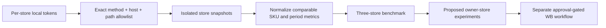
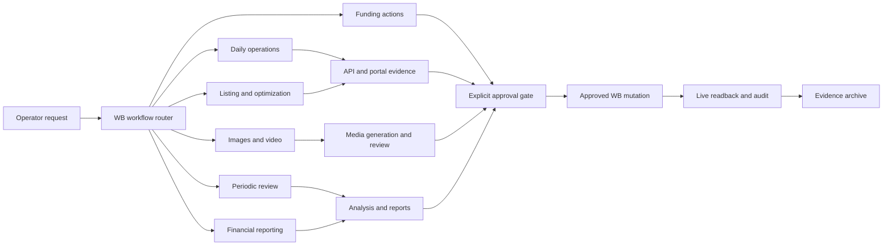

# WB Store Manager

> A local-first Wildberries operations toolkit and Codex Skill that turns seller APIs, product files, media, and operating evidence into safe, resumable workflows.

[](LICENSE)


WB Store Manager helps an operator move from scattered scripts to a controlled operating loop:

`collect facts -> analyze -> prepare dry run -> approve -> execute -> read back -> audit -> archive`

It is intentionally conservative. Read-only collection is the default, sensitive values stay local, marketplace mutations require explicit scope approval, and an HTTP success is not treated as completion until the affected live state is read back.

## Why this project

Marketplace work crosses product facts, profitability, media, content, prices, FBS fulfilment, buyer questions, advertising, and reporting. The difficult part is not making one API request; it is keeping every step traceable and preventing a stale file, wrong variant, or unverified write from becoming buyer-visible.

WB Store Manager provides:

- one category knowledge base generated from source files;
- product and variant truth gates before listing work;
- profitability and WB-account-currency checks before price publication;
- dry-run-first listing, price, media, warehouse, and stock operations;
- live readback and buyer-perspective audits after publication;
- daily snapshots, funnel analysis, question review, and evidence reports;
- a reusable `wb-product-workflow` Codex Skill with six fixed workflows;
- local audit artifacts without committing tokens or private business data.

## Multi-store read-only intelligence

The separate `wb-store-intelligence` Skill compares an owner store with reference stores while making marketplace mutations impossible at the application layer. It collects cards and SKU structure, media metadata, prices, warehouses, FBS/WB stock, seven-day sales funnels, search analytics, advertising, promotions, feedbacks, questions and seller metadata when the token categories permit them.



Tokens may have broader WB permissions, but `wb-intel` accepts only the declared read endpoints. `PUT`, `PATCH`, `DELETE`, unknown hosts, encoded paths, redirects and unlisted `POST` requests are rejected before a token is loaded or a network call begins.

Copy the example registry and create the ignored local token file:

```powershell
Copy-Item config/store-intelligence.example.json config/store-intelligence.local.json

# config/store-intelligence.tokens.local.env
WB_INTEL_BENCHMARK_A_TOKEN=replace_with_store_a_token
WB_INTEL_BENCHMARK_B_TOKEN=replace_with_store_b_token

python -m wb_store_intelligence validate-config `
  --config config/store-intelligence.local.json `
  --token-file config/store-intelligence.tokens.local.env

python -m wb_store_intelligence collect-baseline `
  --config config/store-intelligence.local.json `
  --token-file config/store-intelligence.tokens.local.env `
  --output data/store_intelligence/snapshots --days 7
```

Run `python -m wb_store_intelligence analyze-three-stores --snapshot <snapshot-dir> --output <comparison-dir>` after a three-store collection. Raw snapshots, local registries, token files and generated comparisons stay out of Git. See the canonical Skill at `.agents/skills/wb-store-intelligence/`.

## Workflow architecture



Every path converges on the same safety contract: prepare evidence, stop for approval before a marketplace mutation, then read back the affected live identity and archive the result.

## Fixed workflows

| Workflow | Stages | Typical result |
| --- | --- | --- |
| Daily operations | collect, analyze, verify, report, archive | Prioritized store-health report with evidence |
| Listing and optimization | sync, confirm, pricing, media, validate, approve, publish, readback, buyer audit, archive | Validated and readback-confirmed sellable SKU |
| Media | facts, brief, generate, review, approve, upload, readback, archive | Approved image/video package with live verification |
| Periodic review | collect, compare, diagnose, recommend, report, archive | SKU/store decisions with confidence and next actions |
| Financial reporting | collect, backfill, reconcile, calculate, verify, report, archive | Completed-order report with explicit data-completeness status |
| Funding actions | preflight, plan, approve, execute, readback, archive | Exact approved advertising funding action with balance readback |

The workflow state tool makes long tasks resumable and blocks out-of-order completion:

```powershell
python .agents/skills/wb-product-workflow/scripts/workflow_state.py new `
  --flow listing `
  --task-id iphone15-blue-128 `
  --subject "iPhone 15 Blue 128 GB" `
  --output data/operations/iphone15-blue-128.json

python .agents/skills/wb-product-workflow/scripts/workflow_state.py validate `
  --file data/operations/iphone15-blue-128.json
```

The state tool records progress only. It never calls WB or bypasses approval.

## Quick start

Requirements: Python 3.12+, a WB seller token with the minimum required permissions, and Codex if you want the AI Skill.

```powershell
git clone git@github.com:haiying-ai/wb-store-manager.git
cd wb-store-manager
python -m pip install -e .
$env:WB_API_TOKEN = "your-rotated-token"
# 真实策略与成本数据不进仓库，先按示例生成本地配置
Copy-Item config/finance/stores.example.json config/finance/stores.json
Copy-Item config/pricing/active_phone_pricing_policy.example.json config/pricing/active_phone_pricing_policy.json
python -m wb_manager ping
python -m wb_manager snapshot
python -m wb_manager summary
```

> 仓库只提供框架、安全模型与示例配置。`config/finance/*.json`、`config/pricing/*.json` 与采购成本表都在 `.gitignore` 中，需各自在本地维护；示例里的费率与成本是 0，不能直接用于生产。

See [WB API Token configuration](docs/wb-token-setup.md) for permission selection, Windows storage, validity, and rotation. Never place a token in a command committed to Git, a report, or a Skill file.

## Core commands

```powershell
# Store health and normalized evidence
python -m wb_manager ping
python -m wb_manager snapshot
python -m wb_manager summary

# Category knowledge base and product gates
python -m wb_manager kb sync --category 手机
python -m wb_manager product review --category 手机 --sku AI22
python -m wb_manager pricing review --category 手机 --sku AI22
python -m wb_manager listing validate --category 手机 --sku AI22

# Read live price state
python -m wb_manager pricing read --nm-id 123456789
python -m wb_manager pricing quarantine --nm-id 123456789
```

Live write commands must be reviewed as dry runs and approved for exact SKUs/nmIDs, values, and stores. After execution, keep the request, response, delayed readback, and final status together.

## Completed-order finance

The finance module maintains one local, append-only ledger for every enabled owner store. Its credential-free registry is `config/finance/stores.json`, which is **not committed**; start from [`config/finance/stores.example.json`](config/finance/stores.example.json) and copy it into place. Every store is included automatically after adding a unique `alias`, opening date, credential **variable names**, local token-file path, and currency. Never put a token value in the registry or Git.

The seven finance commands are:

```powershell
# First run: all available history from each store opening through yesterday
# (at most two distinct-token stores are read concurrently; use 1 if needed)
python -m wb_manager finance bootstrap --max-store-workers 2

# Daily repair/sync; the local schedule runs this at 09:30 Asia/Shanghai
python -m wb_manager finance daily --max-store-workers 2

# Append an approved historical cost version; a date starts at Moscow 00:00
python -m wb_manager finance cost-import --quote "E:\path\approved-quote.xlsx" --effective-from 2026-07-04 --approved-by "operator-name" --source-currency RUB --rub-per-cny 11.5

# Create or restate a bootstrap, weekly, or monthly report
python -m wb_manager finance report --kind weekly --period auto

# Plan-only calculation from a FINAL or RESTATED weekly report
python -m wb_manager finance funds-plan --report-id "weekly-report-id"

# Build one immutable balance-funded campaign plan after GET-only live preflight
python -m wb_manager finance ads-deposit-plan --funds-plan "E:\path\weekly-funds-plan.json" --store "owner-store" --campaign 1234567 --amount-cny 100 --approved-by "operator-name"

# Record the exact immutable advertising-deposit plan as a dry-run proposal
python -m wb_manager finance ads-deposit --plan "E:\path\approved-plan.json" --approved-by "operator-name"

# After reviewing that recorded proposal, approve and execute the exact same fingerprint
python -m wb_manager finance ads-deposit --plan "E:\path\approved-plan.json" --approved-by "operator-name" --confirm-live
```

The 09:30 daily run backfills missed dates before syncing yesterday. Ordinary days use a 30-day correction sweep; Monday/month-start uses 120 days, while source-specific statistics cursors resume from their own watermark with a one-day overlap. API reads are bounded by store and same-token stores are serialized; all SQLite writes remain deterministic and serial. The first report is cumulative from store opening; ordinary weekly reports cover the prior Monday through Sunday, and ordinary monthly reports cover the prior calendar month. `PENDING_DATA` means required settlement or store evidence is still incomplete, `FINAL` means every completeness gate passed, and `RESTATED` is a new immutable correction linked to an earlier final report. A report is delivered as three matching artifacts: canonical JSON, Simplified-Chinese Markdown, and a verified XLSX workbook. Repository defaults use `outputs/`; scheduled installations may set `WB_FINANCE_CANONICAL_WORKBOOK`, `WB_FINANCE_REPORT_ROOT`, and `WB_FINANCE_CASH_EVENTS` to local paths. The real cash-event registry stays local and Git-ignored; a tracked empty example keeps clean checkouts runnable. XLSX generation uses the Codex bundled Node spreadsheet runtime (`@oai/artifact-tool`); a fresh checkout must load workspace dependencies and expose that package through a local, Git-ignored `node_modules` junction.

Financial calculation is fail-closed:

- purchase cost uses the cost version effective when the order was created;
- return logistics comes from actual linked WB finance rows—there is no fixed fallback amount;
- the managed-operations fee, the advertising/return reserves and the payment/withdrawal reserve are read from the local active policy file; each order follows the reserve model in effect at its creation time, actual return logistics reconciles only the applicable return reserve, and campaign spend is never deducted a second time;
- the first cumulative history is informational and creates no retroactive funding obligation; afterward `suggested withdrawal = max(0, platform available balance - post-activation unallocated advertising accrual - approved/executing unread advertising deposits - other locked funds)`;
- withdrawal is a plan-only amount and remains a manual seller-portal action because WB has no supported public withdrawal API;
- campaign-budget allocation is the only supported money write. It uses the same store's WB mutual-settlement `balance` (`net`, `type=1`); no separate withdrawal or external cash recharge is required. The immutable plan freezes store, campaign, CNY amount, source balance and evidence time, the ledger-derived advertising reserve, approver, approval time, and expiry. `policyCapCny` is not self-declared: it must exactly equal that current ledger-derived reserve under the active finance policy;
- `ads-deposit-plan` accepts one store and one campaign, forces `balance` (`type=1`), rejects non-integer CNY or any amount above the current ledger reserve, and performs only campaign/budget/currency/balance GET requests. Promotional bonuses and cashback are never selected. WB later nets advertising charges from future sales on its settlement cycle; those deductions reconcile the advertising reserve and are not charged again as other platform cost;
- the first command records a `proposed` ledger event and never writes to WB. `--confirm-live` requires that exact prior proposal, records the approval transition under the store funds lock, then rechecks campaign ownership/status, campaign budget, same-token seller-balance currency, source balance, policy cap, and reserve before the single non-retried POST;
- an unknown POST outcome triggers one immediate read-only campaign-budget check. Later calls with the same fingerprint remain readback-only—never another POST—until the expected budget delta is confirmed or the action remains `unknown`.

## What it covers

- Content: cards, trash, errors, tags, limits, characteristics, listing packages.
- Prices: live reads, upload tasks, quarantine, account-currency validation, delayed readback.
- Marketplace: warehouses, FBS orders, stock planning, exact-barcode verification.
- Analytics and statistics: stock, orders, sales, sales funnel, store snapshots.
- Finance: multi-store completed-order ledger, historical costs, return reconciliation, weekly/monthly owner reports, withdrawal plans, and approval-gated advertising funding.
- Customer experience: unanswered questions, buyer-risk review, post-publish audit.
- Media: staged image sets, ordering, scoring, upload planning, live verification, promo video workflow.
- Codex operations: fixed workflow routing, approval gates, resumable state, evidence archiving.

## Data layout

WB category folders live under `E:/电商运营/01平台资料/01WB/<category>`:

```text
<category>/
├── 00知识库/    # generated facts, manifests, indexes and missing facts
├── 01来源资料/  # immutable source files
├── 02生成资料/  # reviews, pricing, prompts and working media
├── 03上线资料/  # approved packages, payloads, responses and readbacks
└── 04运营资料/  # snapshots, audits and reports
```

## Safety model

1. Keep credentials in environment variables and rotate them before expiry.
2. Treat source facts and confirmed live readbacks as truth; never invent product facts or barcodes.
3. Keep variants isolated by article, barcode, price, media, and stock.
4. Require explicit approval for card, price, discount, advertising, warehouse, stock, and media mutations.
5. Require human visual review for buyer-facing media.
6. Read back the same store and sellable identity after every mutation.
7. Keep supplier terms, costs, private strategies, credentials, and raw private exports out of Git.

## Project structure

- `wb_manager/`: Seller API client, domain services, knowledge base, listing, pricing, and reporting logic.
- `.agents/skills/wb-product-workflow/`: canonical WB Codex Skill, references, assets, and workflow-state tool.
- `tests/`: unit and workflow safety tests.
- `docs/`: setup and operating documentation.
- `data/`: local snapshots and evidence; sensitive runtime artifacts are not publication material.

## Development

```powershell
pip install -e . pytest pillow openpyxl
python -m pytest -q
```

**The test suite is written against the author's full operating configuration, which is not published.** This repository ships `config/**/*.example.json` only, and `tools/` holds five of the automation scripts but not all of them. On a clean clone you should expect a large block of tests to fail or fail to collect — that is a gap in this repository, not a bug introduced by your change.

Practical guidance:

- Run the subset that matches what you changed, and make sure it passes, e.g. `python -m pytest tests/test_finance_calculations.py -q`
- Do not "fix" a failing test by relaxing its numbers; the assertions encode settlement rules (tax basis, refund handling, fee rounding)
- If you want the full suite green, you need your own `config/finance/*.json` and `config/pricing/*.json` — see `tests/conftest.py` for the synthetic-policy pattern to copy

Reusable WB workflow changes should also be reflected in the multi-platform / multi-store wrapper, which is maintained in a separate private repository and is not distributed with this one.

## License

[Apache-2.0](./LICENSE)
